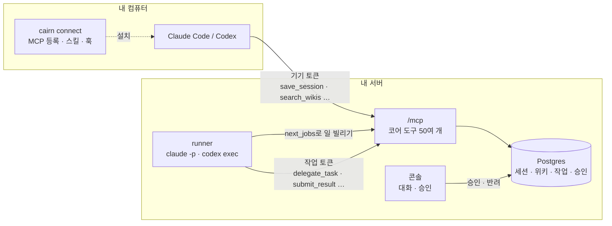
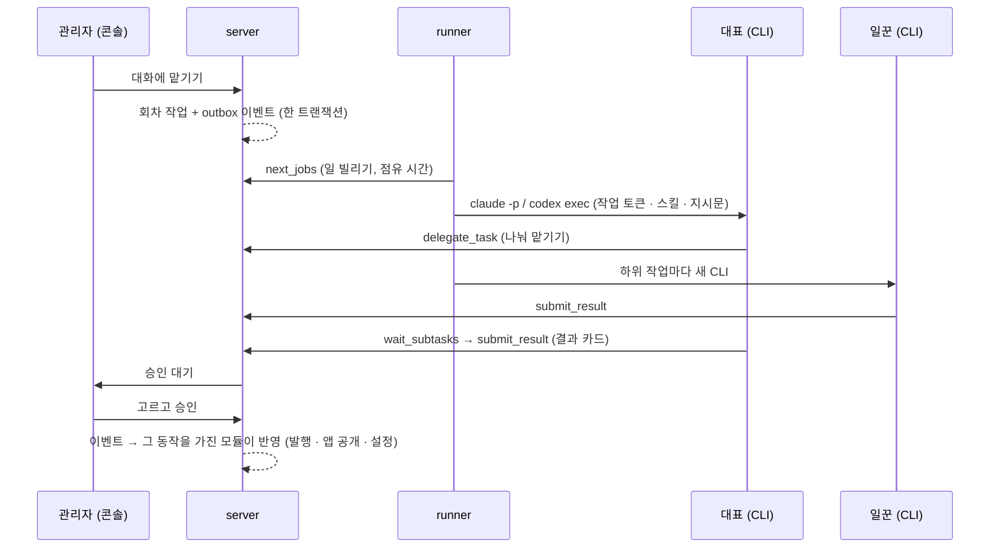
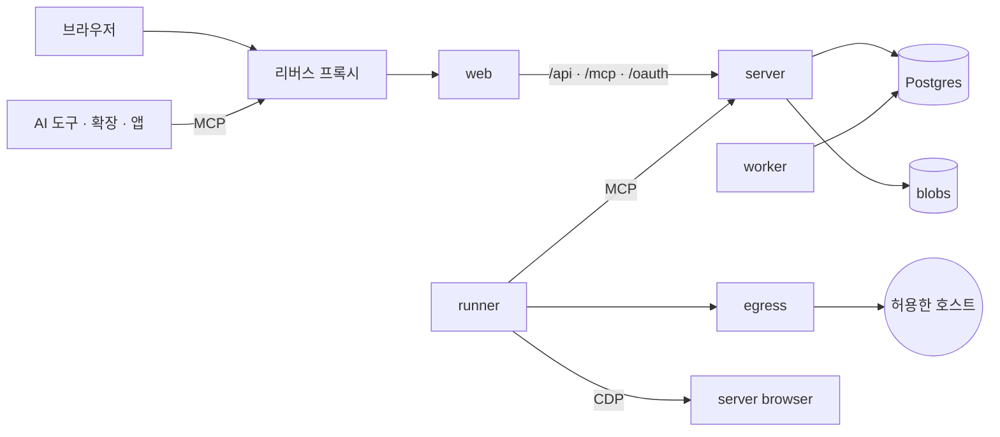

<div align="center">


# Moida

**내 서버 하나에서 도는 Personal AI OS**

흩어진 AI 작업 세션을 모아 지식으로 쌓고, 에이전트 팀에게 일을 맡긴 뒤 결과만 승인하고,<br>
그 결과를 블로그 · 매거진 · 웹 앱으로 내보내는 self-hosted 오픈소스입니다.


[빠른 시작](#빠른-시작) · [에이전트 구조](#에이전트-구조) · [개발 구조](#개발-구조) · [기술 스택](#기술-스택) · [문서](#문서)

</div>

---

## Moida가 하는 일

Claude Code나 Codex로 일하면 세션이 컴퓨터마다 흩어지고, 같은 문제를 또 처음부터 풉니다. Moida는 그 세션을 내 서버로 모아 위키와 그래프로 정리하고, 다음 작업이 그것을 찾아 쓰게 합니다. 이름은 '모이다'에서 왔습니다. 흩어진 기록과 일, 사이트와 사람이 한곳에 모입니다.

> 이름을 Cairn에서 Moida로 바꾸는 중입니다. 명령(`pnpm cairn`) · 선언서(`cairn.json`) · 환경 변수(`CAIRN_*`) 같은 식별자는 아직 예전 이름 그대로입니다.

| | |
|---|---|
| **모으기** | "이 세션 저장해" 한마디로 방금 일한 AI가 노트를 써서 서버로 보냅니다. Claude Code는 세션이 끝날 때 원문도 저장합니다 |
| **찾기** | 다른 컴퓨터에서 "전에 어떻게 했지?"라고 물으면 AI가 MCP로 세션과 위키를 찾아 답합니다 |
| **맡기기** | 콘솔 대화에서 일을 맡기면 대표 에이전트가 일꾼들에게 나눠 주고, 결과를 카드 한 장으로 모아 옵니다. 사람은 고르고 승인만 합니다 |
| **내보내기** | 결과는 스토어의 앱(블로그 · 매거진 · 페이지 앱 · 커뮤니티)으로 나갑니다. 앱은 화면만 만들고, 회원 · 데이터 · 버전 · 도메인은 Moida가 줍니다 |
| **되풀이** | 매일 할 일은 대화에서 자동화(스케줄)로 걸어 둡니다 |

> **상태**: 1~7단계, 2차 버전 "서브 나", 스토어(앱 · 도메인 · 커뮤니티 · 앱 플랫폼)까지 구현했습니다. 실제 환경 확인과 정식 배포 전이라 코드 기여는 아직 받지 않습니다.

## 빠른 시작

필요한 것: Docker Compose가 있는 리눅스 서버(RAM 2GB 이상), 도메인, git. 서버에 Node.js는 없어도 됩니다.

**1. 서버 띄우기**

```bash
git clone https://github.com/KangminNa/cairn.git && cd cairn
cp .env.example .env
```

```ini
# .env
COMPOSE_FILE=docker-compose.prod.yml
DB_PASSWORD=<긴 임의 값>
CAIRN_SECRET_KEY=<openssl rand -base64 32 결과>
CAIRN_WEB_URL=https://cairn.example.com
```

```bash
docker compose up -d --build
docker compose logs server | grep 설치      # 설치 코드가 나옵니다
```

Moida는 컨테이너 여러 개(db · migrate · server · worker · web · runner)가 함께 도는 구성입니다. 이미지 하나만 지어 띄우면 동작하지 않습니다.

**2. https 프록시 연결** (Caddy 예시. 서버 · 웹 포트는 127.0.0.1에서만 열립니다)

```caddyfile
cairn.example.com {
	@server path /api/* /mcp /oauth/* /.well-known/*
	reverse_proxy @server 127.0.0.1:4000
	reverse_proxy 127.0.0.1:3000
}
```

**3. 설치 마법사**: `https://cairn.example.com/install`에서 설치 코드 → 관리자 계정 → 사이트 정보 → 플러그인 순서로 진행합니다.

**4. 작업하는 컴퓨터 연결** (이 저장소를 받아 `pnpm install` 한 뒤)

```bash
pnpm cairn connect https://cairn.example.com               # Claude Code
pnpm cairn connect https://cairn.example.com --tool codex  # Codex
```

**5. 러너 로그인**: 콘솔 › 설정 › AI 계정에서 "브라우저로 로그인"을 눌러 Claude 또는 ChatGPT 구독으로 로그인하면 서버의 러너가 일을 시작합니다.

업데이트는 `git pull && docker compose up -d --build`입니다. 앱마다 도메인, 서버 브라우저, 코드 러너, 텔레그램, 백업, 문제 해결은 [설치 문서](docs/설치.md)에 있습니다.

<details>
<summary><b>개발 환경</b></summary>

```bash
pnpm install
cp .env.example .env     # CAIRN_SECRET_KEY= 뒤에 pnpm secret:new 결과
pnpm dev                 # db → migrate → server(:4000) · worker → web(:3000)
pnpm install-code        # http://localhost:3000/install 에 넣을 코드
```

작업을 마치기 전에 `pnpm check`(린트 · 타입 · 모듈 경계 · 구조 · 규칙 · 안 쓰는 코드)와 `pnpm test`(테스트 전용 DB에서 단위 · API · 러너 통합 테스트)를 통과시킵니다. 명령 전체는 [AGENTS.md](AGENTS.md).

</details>

---

## 에이전트 구조

Moida의 에이전트 구조는 세 가지 결정에서 나왔습니다.

1. **서버에는 AI가 없습니다.** 서버는 데이터 · 권한 · 승인만 다룹니다. AI가 할 일은 모두 "빌려 가는 일"로 표에 남고, 러너나 사용자의 AI 도구가 가져가서 처리합니다. 그래서 서버는 결정적으로 테스트할 수 있고, AI 제품이 바뀌어도 서버는 그대로입니다.
2. **AI는 공식 CLI 안에서 돕니다.** 모델 API를 직접 부르지 않고 Claude Code(`claude -p`)와 Codex(`codex exec`)를 그대로 띄웁니다. 개인 구독은 공식 CLI 안에서만 쓸 수 있고, CLI에는 이미 파일 편집 · 셸 · 세션 재개 · 스킬이 있어 에이전트 루프를 다시 만들 필요가 없습니다. Moida가 정하는 것은 그 CLI에게 무엇을 보여 주고 무엇을 막을지입니다.
3. **서버와 AI 사이는 MCP 하나입니다.** 내 노트북의 Claude Code, 서버의 러너, 브라우저 확장, Claude · ChatGPT 앱이 모두 같은 `/mcp`로 들어옵니다. 누가 무엇을 할 수 있는지는 토큰에 담기고, 서버가 도구를 부를 때마다 확인합니다.



### 내 컴퓨터: `cairn connect`

`packages/cli`의 연결 명령 하나가 AI 도구를 Moida에 붙입니다.

| 하는 일 | Claude Code | Codex |
|---|---|---|
| MCP 서버 등록 | `claude mcp add --transport http` | `codex mcp add` |
| 로그인 | 브라우저에서 OAuth 2.1, 기기마다 권한을 골라 승인 | 같음 |
| 스킬 | `cairn-save` · `cairn-recall` · `cairn-team` → `~/.claude/skills` | 같은 스킬 → `~/.agents/skills` |
| 훅 | `SessionEnd`: 세션 원문 저장 (못 올리면 `~/.cairn/outbox`에 두었다 다음에)<br>`UserPromptSubmit`: 서버 팀의 새 소식을 대화에 덧붙이고 상태 줄에 표시 | 없음 |

그다음부터는 평소처럼 쓰면 됩니다. "이 세션 저장해"는 `cairn-save` 스킬이 노트를 써서 `save_session`으로 보내고, "전에 어떻게 했지?"는 `cairn-recall`이 `search_sessions` · `search_wikis`로 찾습니다.

### 서버: 러너가 일을 처리하는 순서



러너(`apps/runner`)는 CLI를 띄울 때 이렇게 가둡니다.

- **빈 설정, 빈 홈**: 사용자의 설정과 다른 MCP 연결을 읽지 않습니다. `--strict-mcp-config`로 넘긴 MCP만 붙습니다 (cairn, 브라우저 일의 Playwright, 관리자가 허락한 커넥터).
- **도구 목록 고정**: 기본은 파일 읽기 · 쓰기와 MCP뿐이고 셸이 없습니다. 쓰기는 작업 폴더 안에서만(`acceptEdits`) 됩니다. 셸은 코드 작업의 칸(Docker 컨테이너, 바깥으로는 `egress` 허용 목록뿐)에서만 엽니다.
- **작업 토큰**: 일마다 새로 만들고, 그 일의 종류가 허락한 도구만 보입니다(`task-kinds.json`). 일이 끝나면 쓸 수 없습니다. 로그인 토큰은 파일이 아니라 환경 변수로만 넘깁니다.
- **세션 이어 가기**: 같은 일의 다음 실행은 CLI 세션을 재개(`--resume`)하고, 인수인계 메모를 남겨 다음 일꾼이 이어받습니다.

### 토큰과 권한

| 토큰 | 누가 | 어떻게 받나 | 할 수 있는 것 |
|---|---|---|---|
| 웹 세션 | 관리자 | 아이디 · 비밀번호 로그인 | 콘솔 전체, 승인 |
| 기기 토큰 | 내 컴퓨터의 AI 도구 · 확장 · 앱 | MCP OAuth 2.1, 관리자가 브라우저에서 승인 | 승인할 때 고른 권한만 (`upload` · `read_all` · `write` · `run` · `delegate` · `news` …) |
| 러너 토큰 | 러너 | 콘솔에서 발급 | 일 빌리기, 결과 올리기 |
| 작업 토큰 | 빌려 간 일 하나의 CLI | 러너가 일을 빌릴 때 서버가 봉인 | 그 일의 종류가 허락한 도구만, 그 일이 살아 있는 동안만 |
| 회원 쿠키 | 커뮤니티 앱의 방문자 | 앱 도메인에서 가입 · 로그인 | 그 앱의 글 · 댓글 · 데이터만. 콘솔과 MCP에는 닿지 않습니다 |

### 지시는 코드가 아니라 파일에

AI에게 가는 글은 코드에 흩어 두지 않습니다.

- `skills/`: 일의 종류마다 하는 법 (`cairn-work` 일반, `cairn-code` 코드, `cairn-make` 결과물과 앱, `cairn-browse` 브라우저, `cairn-write` 글 …). 러너는 서버가 일과 함께 준 스킬 버전을 씁니다. 콘솔에서 고친 버전이 저장소 판 위에 쌓이고, 버전마다 첫 판정 통과율을 봅니다.
- `skills/cairn-runner/references/prompts.md`: 지시문 틀. 러너와 서버는 값만 채웁니다.
- `apps/server/src/modules/*/<모듈>.tools.ko.json`: MCP 도구 설명. 콘솔에서 고칠 수 있습니다.

### 모델이 지키는 규칙과 런타임이 막는 규칙

모델은 지시를 대체로 따르지만 늘 따르지는 않습니다. 그래서 같은 규칙을 여러 겹에 둡니다.

| 겹 | 어디서 | 예 |
|---|---|---|
| 지시 | 스킬, 지시문, 도구 설명 | 앱 코드의 데이터 약속, 디자인 기준, 도구를 고르는 순서 |
| 러너 검사 | 결과를 내기 전. 틀리면 AI에게 한 번 더 | 앱 코드 모양(`AppCodeCheck`), 디자인 기준 검사 |
| 서버 검사 | 최종 판단. 고칠 수 있는 문구로 거절 | 앱 선언서(`AppManifest`), 입력 모양, 하루 · 분당 한도 |
| 격리와 권한 | AI가 만든 것은 남의 코드로 | 앱 화면 sandbox와 CSP, 작업 토큰의 도구 목록, 코드 칸의 허용 목록 |
| 사람 승인 | 되돌릴 수 없는 일 | 발행 · 전송 · 삭제 · 권한 · 설정 바꾸기 |

비밀번호 · 결제 수단 · 인증 번호는 AI를 거치지 않습니다. 사람이 서버 브라우저 화면이나 로그인 카드에 직접 넣고, AI 없는 러너가 그 사이트의 칸에만 넣습니다.

한 번이라도 지시를 어겼고 그 결과가 보안 · 비밀 · 돈 · 되돌릴 수 없는 일에 닿으면, 그 규칙은 지시에서 런타임 검사로 올립니다. 예를 들어 앱을 만드는 AI가 스킬을 어기고 지도 회사 SDK와 키를 직접 넣으려 한 뒤로는, 서버와 러너가 그런 앱 선언서를 거절합니다.

---

## 개발 구조

```
apps/
  server/      NestJS. REST(/api) · MCP(/mcp) · OAuth. 도메인 규칙과 승인의 최종 판단
    src/modules/<모듈>/   모듈 하나 = Postgres 스키마 하나 (지도: apps/server/modules.json)
  web/         Next.js App Router. 콘솔(app/admin) · 앱 화면(app/(blog)/[app]) · 회원 화면
  runner/      일을 빌려 Claude Code · Codex CLI로 처리. MCP로만 서버와 이야기하고 DB에 닿지 않음
  egress/      코드 러너 칸이 나가는 프록시 (허용 목록의 호스트로만 HTTPS)
  extension/   브라우저 확장 (Chrome MV3). 웹 AI 대화 모으기, 맡기기
packages/cli/  cairn connect · status · app deploy
plugins/       코어를 고치지 않는 기능 (지도 · 텔레그램 · 서버 브라우저 · GitHub 연동 …)
skills/        AI에게 가는 하는 법과 지시문 틀
db/            Postgres 17 이미지(pgvector · pg_bigm)와 SQL 마이그레이션
scripts/       모듈 경계 · 구조 · 규칙 · 스킬 검사, 묶음 생성기
docs/          설계 문서
```

### 실행 단위



| 단위 | 하는 일 | DB |
|---|---|---|
| web | 서버 API만 부릅니다. 앱 화면은 route handler가 앱 코드의 템플릿을 채워 격리 머리글과 함께 보냅니다 | 닿지 않음 |
| server | 모든 쓰기와 권한 판단. 같은 트랜잭션에 outbox 이벤트를 남깁니다 | 읽기 · 쓰기 |
| worker | server와 같은 이미지. outbox 이벤트와 마감 작업을 처리하고, `LISTEN` 신호와 타이머로만 깹니다 (쉬는 동안 DB를 조회하지 않음) | 읽기 · 쓰기 |
| runner | 서버 컨테이너 안이나 내 컴퓨터에서 돕니다. 여러 일을 함께 처리합니다 | 닿지 않음 |

원본은 Postgres 하나입니다. Markdown과 zip은 내보내기 형식이고, 사진 · 결과물 · 앱 코드 파일은 해시로 가리키는 blobs에 둡니다.

### 서버 모듈

| 모듈 | 하는 일 |
|---|---|
| `platform` | 기반 클래스, 요청자(Actor), outbox, 변경 신호, 파일, 보관 형식, 플러그인, 알림. 비즈니스 규칙 없음 |
| `account` | 공간, 관리자 로그인, 기기, 토큰. Guard가 요청마다 Actor를 만듭니다 |
| `vault` | AI 작업 세션과 지식 그래프 (세션과 위키는 판을 추가만 하고 되돌릴 수 있음) |
| `blog` | 스토어의 앱과 글 엔진 (앱, 앱 코드 버전, 글, 메뉴, 호, 페이지) |
| `task` | 에이전트가 일하고 관리자가 승인하는 구조 (작업, 대화, 승인, 러너, 스케줄, 결과물, 커넥터, 스킬) |
| `community` | 앱의 회원 · 글 · 신고 · 약관과 앱 데이터 (앱마다 `app_<id>` 스키마, 행 수준 보안) |
| `mcp` | AI 도구의 입구. 각 모듈의 `*.tool.ts`를 모아 엽니다 |

<details>
<summary><b>모듈을 잇는 규칙과 코드 계층</b></summary>

- import는 `platform`만 합니다 (입구인 `mcp`는 각 모듈의 `index.ts`). 다른 모듈의 표에 SQL을 쓰지 않고, 모듈 사이 외래키가 없습니다.
- 다른 모듈의 데이터는 platform의 등록부(`Lookups` · `Leases` · `SettingKinds` · `ActionChecks`)로 묻고, 후속 일은 outbox 이벤트로 알립니다. 누가 주고 누가 묻는지는 `modules.json`에 적고 `pnpm check`가 코드와 맞춰 봅니다.
- 한 모듈 안은 네 층입니다.

```
진입   Controller(*.api.ts) · Tool(*.tool.ts) · Guard · View(*.view.ts)
응용   Input(모양 검사) · Service(쓰기, 트랜잭션 하나) · Query(읽기, Actor로 공개 범위를 거름)
도메인 Entity(규칙과 상태) · Policy(판단) · Actor(누가)
저장   Repository(표 하나) · Gateway(바깥 서비스)
```

- 항상 같이 바뀌는 데이터 하나가 폴더 하나이고, 쓰기는 Service 하나, 읽기는 Query 하나에 모읍니다. 표의 칸을 아는 곳은 생성된 표 인터페이스, Entity의 규칙, Input, View뿐입니다. 자세한 것은 [객체 설계](docs/객체설계.md).

</details>

### 확장: 플러그인

코어가 몰라도 되는 기능은 `plugins/<이름>/`에 둡니다. 목록 파일(`cairn-plugin.json`)에 적은 확장 지점만 쓸 수 있고, 서버 코드는 `apps/server/src/plugin-api.ts`만 가져옵니다. 기능 패키지는 자기 스키마, REST 경로(`/api/p/<이름>/…`), MCP 도구, 콘솔 메뉴를 가질 수 있습니다. 예: 서버 브라우저(`browser-tabs`), 코드 작업(`code-github`), 텔레그램(`messenger-telegram`), 지도와 장소 찾기(`map`).

---

## 기술 스택

| 영역 | 쓰는 것 | 고른 까닭 |
|---|---|---|
| 서버 | NestJS, TypeScript | 모듈과 의존성 주입으로 도메인 모듈 경계를 코드 구조에 그대로 옮길 수 있습니다 |
| DB | PostgreSQL 17, pgvector, pg_bigm | 원본을 하나로 둡니다. 한국어 부분 검색(pg_bigm), 의미 검색(pgvector), 앱 데이터의 행 수준 보안, `LISTEN/NOTIFY`로 실시간 신호와 일꾼 깨우기까지 DB 하나로 합니다 |
| 쿼리와 마이그레이션 | drizzle-orm(쿼리 빌더로만), postgres.js, dbmate | 마이그레이션은 SQL 그대로 두고, 표 인터페이스는 DB에서 생성합니다. 라이브러리는 `platform/base` 안에서만 씁니다 |
| AI 연결 | MCP(`@modelcontextprotocol/sdk`, Streamable HTTP), OAuth 2.1 | 어떤 AI 클라이언트든 같은 입구로 붙고, 권한을 토큰에 담습니다 |
| 에이전트 | Claude Code CLI, Codex CLI, `@playwright/mcp` | 공식 CLI의 에이전트 루프를 그대로 쓰고, 러너는 가두고 이어 주는 일만 합니다 |
| 격리 | Docker 칸, egress 허용 목록 프록시, neko(Chromium, CDP) | 코드와 브라우저 일은 내 서버 안에서 돌지만 바깥으로는 허락한 곳만 나갑니다 |
| 웹 | Next.js App Router, React, Tiptap, unified(remark, rehype-sanitize), Mustache | 콘솔은 React, 앱 화면은 앱 코드의 템플릿을 서버에서 채워 격리해 보냅니다 |
| 품질 | Biome, tsc, knip, `node:test`, 자체 검사(모듈 경계 · 구조 · 규칙 · 스킬) | 규칙을 문서에만 두지 않고 `pnpm check`가 막습니다 |
| 배포 | Docker Compose | 서버 한 대에서 `git pull && docker compose up -d --build`로 업데이트합니다 |

라이브러리를 고른 기준과, 설계만 참고해 직접 만든 것(outbox, 작업 임대, 판 쌓기 등)은 [쓴 오픈소스와 참고한 오픈소스](docs/오픈소스.md)에 있습니다.

## 문서

| 문서 | 내용 |
|---|---|
| [설치](docs/설치.md) | 운영 설치, 앱 도메인, 서버 브라우저, 코드 러너, 백업, 문제 해결 |
| [기획서](docs/기획서.md) | 무엇을 왜 만드는지, 원칙, 단계, 결정 기록 |
| [객체 설계](docs/객체설계.md) · [테이블 설계](docs/테이블설계.md) · [API 설계](docs/API설계.md) | 서버 코드, 표, REST와 MCP |
| [서브 나](docs/서브나.md) | 대표에게 맡기고 결과만 승인하는 에이전트 구조 |
| [스토어](docs/스토어.md) | 앱, 앱 코드, 도메인, 커뮤니티, 앱 플랫폼 |
| [MCP](docs/MCP.md) · [브라우저](docs/브라우저.md) · [코드 작업](docs/코드작업.md) · [지도](docs/지도.md) | 커넥터, 서버 브라우저, 코드 러너, 지도 플러그인 |
| [보관 형식](docs/보관형식.md) | 내보내기, GitHub 동기화, 복원 |
| [AGENTS.md](AGENTS.md) | 이 저장소에서 일하는 규칙 (사람과 AI 도구 공통) |

## 라이선스

[AGPL-3.0](LICENSE). Moida를 고쳐서 서비스로 운영하면 고친 코드를 공개해야 합니다.
