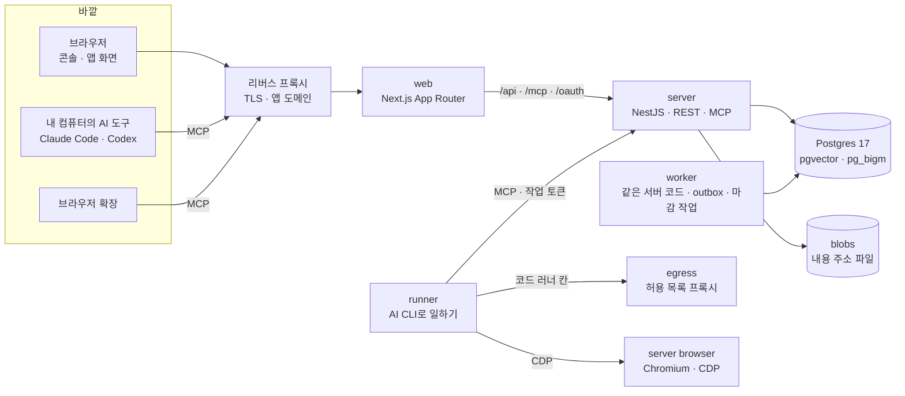
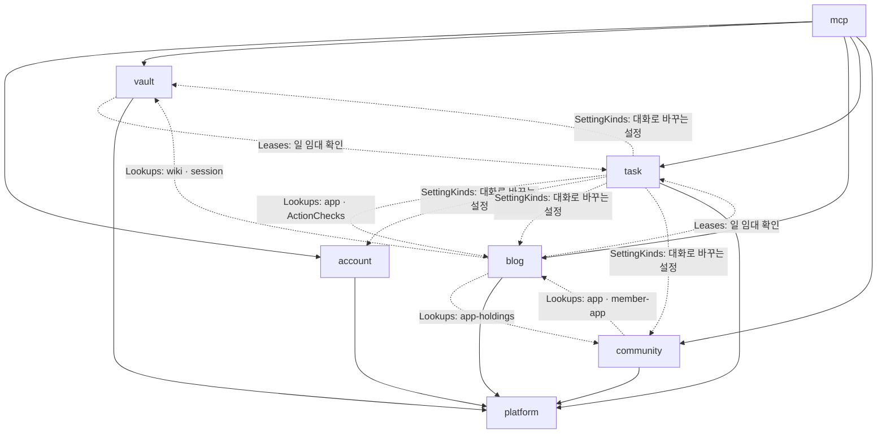

# Cairn

**내 서버 하나에서 도는 Personal AI OS. 흩어진 AI 세션을 모아 지식으로 키우고, 에이전트에게 작업을 맡겨 결재하고, 결과를 스토어의 앱(블로그 · 매거진 · 페이지 앱)으로 내보내는 self-hosted 오픈소스.**

> 상태: 1~7단계(스케줄 · 알림 포함), 2차 버전 "서브 나"([docs/서브나.md](docs/서브나.md)), 스토어([docs/스토어.md](docs/스토어.md): 앱 · 앱마다 자기 코드 · 앱마다 도메인 · 커뮤니티 · 앱 플랫폼)까지 구현했습니다. 실제 환경 확인과 정식 배포 전입니다.

## 하는 일

Claude Code나 Codex로 일하면 작업 세션이 컴퓨터마다 흩어지고 다시 열리지 않습니다. Cairn은 세션을 내 서버에 모읍니다. 세션 하나가 돌 하나라면, 쌓인 돌탑이 다음 작업의 길잡이가 됩니다.

- **"이 세션 저장해"** 라고 하면 방금 일한 AI가 세션 노트를 써서 내 서버로 보냅니다.
- 러너가 세션을 위키로 정리하고 이어서 그래프로 키웁니다. 서버 본체에는 AI가 없습니다.
- 다른 컴퓨터에서 **"전에 어떻게 했지?"** 라고 물으면 AI가 MCP로 찾아 답합니다.
- 콘솔의 **대화**에서 일을 맡기면 대표가 받아 일꾼들에게 나눠 맡기고, 결과를 카드 한 장으로 모아 줍니다. 사람은 결과를 골라 승인만 합니다. 발행 · 전송 · 삭제 같은 위험한 동작은 승인 뒤에만 실행됩니다.
- 결과는 스토어의 앱(블로그 · 매거진 · 페이지 앱 · 커뮤니티)으로 내보냅니다. 앱마다 자기 HTML · CSS · JS 코드로 그려지고, 대화로 AI에게 화면을 고치게 한 뒤 미리 보고 공개합니다.
- 앱은 화면만 만들면 됩니다. 회원 가입 · 로그인, 앱 데이터(표), 버전, 승인, 도메인은 Cairn이 줍니다 (선언서 `cairn.json`, [스토어 12장](docs/스토어.md)).
- 되풀이할 일은 대화에서 자동화(스케줄)로 걸어 둡니다.

왜 만드는지와 원칙은 [기획서](docs/기획서.md)에 있습니다.

### 콘솔 한눈에

| 화면 | 하는 일 |
|---|---|
| 대화 | 대표에게 일을 맡기고 결과 카드를 승인 · 수정 요청 |
| 일꾼 | 대표와 일꾼 목록, 일꾼마다 이번 달 사용량(한도가 있으면 한도에서의 비율, 없으면 전체에서의 몫), 작업 기록 |
| 스토어 | 내 앱 · 앱 만들기 · 앱 관리(글 · 메뉴 · 코드 · 도메인 · 커뮤니티 · 데이터) |
| 승인 | 승인을 기다리는 동작 |
| 보관함 | 결과물 · 페이지 · 스크랩 · 위키 · 지식 그래프 · 세션 · 글 |
| 설정 | AI 계정과 **사용량**(구독을 쓴 비율 · 남은 비율 · 초기화 시각, 일꾼별 토큰), 커넥터, 사이트, 알림, 계정, 보안. "고급"에 목표 · 스케줄 · 처리 실패 · 러너 · 연결된 기기 · 플러그인 · 스킬 |

## 설치

필요한 것: Docker(Compose 포함), git, 도메인, RAM 2GB 이상인 서버. 서버에 Node.js·pnpm은 없어도 됩니다.

**1. 서버 띄우기**

```bash
git clone https://github.com/KangminNa/blog.git cairn
cd cairn
cp .env.example .env
```

`.env`에 아래 값을 넣습니다. 사이트 주소·플러그인은 `.env`가 아니라 설치 마법사에서 정합니다.

```ini
COMPOSE_FILE=docker-compose.prod.yml            # 운영 구성: 컴파일한 이미지, root가 아닌 사용자
DB_PASSWORD=<긴 임의 값>                         # DB를 처음 만들 때 정해져서 나중에 바꾸지 않습니다
CAIRN_SECRET_KEY=<openssl rand -base64 32 결과>  # 비밀값 암호화 키. 바꿀 때는 .env.example의 순서를 따릅니다
CAIRN_WEB_URL=https://내블로그주소               # 사람이 여는 주소
```

```bash
docker compose up -d --build
docker compose logs server | grep 설치     # 설치 코드
```

업데이트는 `git pull && docker compose up -d --build`입니다. 새 마이그레이션은 `migrate`가 적용하고, 서버 · 일꾼(worker) · 러너 · 웹 컨테이너가 새 이미지로 다시 만들어집니다. 올린 사진과 결과물 파일은 `blob-data` 볼륨에 있으니 DB(`db-data`)와 함께 백업합니다. 이 볼륨은 `server`와 `worker`가 함께 씁니다 (compose 파일을 고쳐 쓴다면 둘 다에 붙어 있어야 합니다).

**2. https 프록시 (Caddy 예시)**

DB(5432)·서버(4000)·웹(3000) 포트는 이 서버 안(127.0.0.1)에서만 열립니다. 밖에는 80·443만 열고 앞에 https 프록시를 둡니다. Caddy는 `/etc/caddy/Caddyfile`에 아래를 넣고 `sudo systemctl reload caddy`. 인증서, http → https, `X-Forwarded-*` 넘기기를 Caddy가 알아서 합니다.

```
내블로그주소 {
	@server path /api/* /mcp /oauth/* /.well-known/*
	reverse_proxy @server 127.0.0.1:4000
	reverse_proxy 127.0.0.1:3000
}
```

프록시가 Docker 컨테이너라면 서버에만 `docker-compose.override.yml`을 만들어(git에 올라가지 않음) 프록시 네트워크에 붙입니다. `proxy-net`은 프록시가 쓰는 네트워크 이름으로 바꾸고, `.env`에는 `COMPOSE_FILE=docker-compose.prod.yml:docker-compose.override.yml`처럼 함께 적습니다.

```yaml
services:
  server:
    networks:
      proxy-net:
        aliases: [cairn-server]
  web:
    networks:
      proxy-net:
        aliases: [cairn-web]

networks:
  proxy-net:
    external: true
```

프록시에서는 `/api` · `/mcp` · `/oauth` · `/.well-known`을 `cairn-server:4000`으로, 나머지를 `cairn-web:3000`으로 보냅니다.

**앱마다 도메인 (선택)**

앱 하나를 자기 도메인으로 열 수 있습니다 (예: 블로그는 `blog.example.com`, 매거진은 `mag.example.com`). 같은 서버 · 같은 컨테이너가 그대로 받고, 앱 도메인에서는 그 앱의 화면 · 파일 · RSS만 열립니다. 콘솔 · 로그인 · 관리 API · MCP는 사이트 주소에서만 열립니다.

1. DNS에서 그 도메인의 A 레코드(또는 사이트 주소로 가는 CNAME)를 이 서버로 둡니다.
2. Caddyfile에 사이트 주소의 블록과 같은 모양으로 블록 하나를 더합니다. 인증서는 Caddy가 받습니다.

```
blog.example.com {
	@server path /api/* /.well-known/*
	reverse_proxy @server 127.0.0.1:4000
	reverse_proxy 127.0.0.1:3000
}
```

3. 콘솔(사이트 주소)의 스토어 › 앱 › 설정 › 도메인에 `blog.example.com`을 저장하고 **연결 확인**을 누릅니다. 브라우저가 그 도메인의 `/.well-known/cairn-domain`을 읽어 서버로 돌려보내면 연결된 것으로 적힙니다 (서버는 밖으로 요청하지 않습니다).
4. 공개 앱이면 그때부터 사이트 주소의 `/<앱>/…`가 그 도메인의 같은 경로로 이동합니다(308). 도메인을 바꾸면 다시 연결 확인을 합니다.

앱 도메인은 사이트 주소와 같을 수 없고, 한 도메인은 앱 하나만 씁니다. 백업에는 들어가지 않으니 다른 서버로 옮기면 앱 설정에서 다시 정합니다.

커뮤니티 앱(스토어 3단계)의 회원 가입 · 로그인 · 글쓰기는 그 앱의 도메인에서만 됩니다 (아이디 · 비밀번호, 따로 설정할 것은 없습니다). 그래서 커뮤니티 앱은 앱 설정에서 도메인을 연결하고 확인해야 공개할 수 있습니다. 회원 화면은 `https://<앱 도메인>/_/join` · `/_/login` 같은 주소이고, 신고 · 글 · 회원 관리는 콘솔의 앱 관리 › 커뮤니티 탭에 있습니다.

**3. 설치 마법사**

`https://내블로그주소/install`을 열고 설치 코드 → 관리자 계정 → 사이트 정보 → 플러그인 → 첫 기기 순서로 진행합니다. **사이트 주소에 `https://내블로그주소`를 꼭 넣습니다.** 기기 연결과 앱 연결이 이 주소를 씁니다. 비밀번호를 잊으면 서버에서 `docker compose exec server cairn-admin owner reset-password`로 다시 정합니다 (모든 로그인이 끝남).

**배포할 때 지킬 것**

- **사이트 주소는 https만 됩니다.** `http://192.168.x.x` 같은 주소는 받지 않습니다. 같은 컴퓨터 안의 `http://localhost`는 됩니다. 집 안에서만 쓸 때는 Tailscale(`tailscale serve`)이나 Caddy의 내부 인증서로 https를 붙입니다.
- **밖에는 프록시만 엽니다.** compose의 포트를 `127.0.0.1` 밖으로 바꾸지 않습니다. Docker가 연 포트는 ufw 같은 방화벽을 거치지 않고, 포트를 직접 열면 IP를 속여 시도 횟수 제한을 피할 수 있습니다.
- **프록시가 할 일**: http를 https로 돌려보내고, `X-Forwarded-Proto`와 `X-Forwarded-For`를 넘기고(없으면 로그인 쿠키에 `Secure`가 붙지 않습니다), 10MB 본문을 받습니다.
- **선택**: 프록시 접속 기록에 주소의 파라미터(`?` 뒤)를 남기지 않고, 서버 디스크를 암호화합니다.

**4. 작업하는 컴퓨터 연결**

```bash
# 노트북에 이 저장소를 받아 pnpm install 한 뒤
pnpm cairn connect https://내블로그주소               # Claude Code
pnpm cairn connect https://내블로그주소 --tool codex  # Codex
```

스킬(`cairn-save`, `cairn-recall`, `cairn-team`)과 검토자를 AI 도구에 넣고, MCP 서버를 등록하고, 브라우저에서 로그인해 이 기기를 연결합니다. 그 도구의 명령줄(`claude` 또는 `codex`)이 필요하고, 한 컴퓨터는 블로그 하나에 연결합니다. `--review-with codex`처럼 다른 회사 모델을 교차 검토자로 고를 수 있습니다.

앱을 내 컴퓨터에서 빌드해 올릴 때는 `pnpm cairn app deploy <앱 주소> <빌드 폴더> --site https://내블로그주소`를 씁니다. 처음에는 브라우저에서 "초안 쓰기 · 앱 코드 올리기"만 가진 배포 기기를 승인하고, 다음부터는 `--site` 없이 올립니다. 공개 앱의 새 버전은 콘솔의 스토어 › 앱 › 코드에서 공개해야 보입니다.

Claude Code는 팀 소식도 받습니다: 브라우저에서 "소식 읽기"만 가진 소식 기기(`<컴퓨터 이름> · 소식`)를 한 번 더 승인하면, 말을 걸 때마다 서버 팀의 새 소식이 대화에 덧붙고(훅) 아래 상태 줄에 `Cairn · 진행 2 · 소식 3`이 보입니다. 열쇠는 `~/.cairn/credentials.json`(나만 읽기), 스크립트는 `~/.cairn/bin`에 둡니다. 쓰고 있던 훅은 그대로 두고, 상태 줄이 이미 있으면 덮지 않고 붙이는 법을 알려 줍니다. 상태는 `pnpm cairn status`로 봅니다.

**Claude 앱 · ChatGPT**는 콘솔 → 기기에서 "ChatGPT·Claude 앱 연결 허용"을 켜고, 앱의 커넥터 설정에 `https://내블로그주소/mcp`를 넣은 뒤 블로그에서 승인하고, 같은 화면의 `cairn-save.zip`을 앱의 스킬에 올립니다. 앱은 그 회사 서버에서 들어오므로 **인터넷에서 열리는 https 주소**가 필요합니다. 집 안 서버라면 Cloudflare Tunnel이나 `tailscale funnel`처럼 밖으로 여는 터널을 씁니다. 앱에서는 대화 원문 대조와 다른 맥락의 검토를 할 수 없어 미리보기에 "독립 검토 아님"이 붙습니다.

**5. 러너 켜기**

정리, 초안, 작업은 러너가 합니다. 대화를 받는 대표는 첫 대화에서 저절로 생기고(설정 › AI 계정에서 AI 도구 · 모델 · 한도를 바꿉니다), 일꾼은 콘솔의 일꾼 메뉴에서 더합니다. 모든 일꾼은 같은 권한으로 같은 일을 하고, 누가 무엇을 맡을지는 대표가 정합니다.

- **서버에서**: 러너는 서버와 함께 뜨고 스스로 연결합니다. 콘솔의 AI 메뉴에서 "브라우저로 로그인"(Claude · Codex 구독)을 누르면 러너가 로그인 명령을 대신 열고, 로그인 페이지에서 받은 코드를 붙여 넣으면 일합니다. 에이전트마다 AI 도구(Claude Code · Codex)를 고릅니다. 서버에 브라우저가 없어도 됩니다 (`claude setup-token`으로 만든 토큰을 직접 넣어도 됩니다). 서버 러너는 일을 3개까지 함께 합니다 (`.env`의 `CAIRN_RUNNER_CONCURRENCY`, 1~8). 콘솔의 러너 메뉴에서 러너마다 바꾸면 그 값이 먼저이고, 러너를 다시 시작하지 않아도 다음 일부터 바뀝니다. 늘리면 서버 메모리와 구독 사용량을 그만큼 더 씁니다.
- **구독 계정의 학습 사용 끄기 (권장)**: 에이전트가 다루는 글 · 원문이 그 구독 계정의 대화로 오갑니다. Claude · ChatGPT(Codex) 계정의 개인정보 · 데이터 설정에서 대화를 모델 학습에 쓰는 항목을 꺼 두세요. Cairn은 에이전트 기록을 쌓기 전에 비밀값을 지우고 개인정보(전화 · 이메일 · 카드 · 주민번호)를 마스킹하지만, CLI에 들어가는 지시까지 거르지는 않습니다.
- **내 컴퓨터에서**: 콘솔의 기기 메뉴 → 러너 추가로 토큰을 받아 `cp apps/runner/.env.example apps/runner/.env`로 값을 채우고 `pnpm runner start`. 기본은 한 번에 일 하나입니다.

**6. 브라우저 에이전트 (선택)**

서버 안에 브라우저(neko 이미지의 Chromium)를 두고, 에이전트가 등록한 사이트에서 일하거나 로그인 없는 새 창으로 공개 사이트를 둘러보게 합니다 (구조와 안전장치는 [docs/브라우저.md](docs/브라우저.md)). 에이전트는 양식을 채우고 마지막 버튼(제출 · 결제 · 게시) 앞에서 멈춥니다. 러너가 그 페이지 · 버튼 · 화면을 붙잡아 결재를 올리고, **승인하면 러너가 같은 페이지 · 같은 버튼인지 확인한 뒤에만 누릅니다.** 다르면 누르지 않고 콘솔 화면에서 직접 하도록 알립니다. 브라우저가 메모리를 0.3~1GB 더 쓰니 RAM 3GB 이상을 권합니다.

화면은 콘솔(설정 › 고급 › 브라우저 › 화면 열기)이나 대화의 로그인 카드에서 봅니다. 서버가 브라우저의 화면을 그림으로 받아 HTTPS로 보여 주고, 누른 자리와 입력한 글자를 브라우저에 보냅니다. **밖으로 여는 포트 · 비밀번호 · 앞단 프록시 설정이 필요 없습니다.**

1. `.env`에 더합니다. ARM 서버(Oracle Ampere · AWS Graviton 등)도 같습니다 (이미지에 amd64 · arm64가 함께 있습니다).

```
COMPOSE_FILE=docker-compose.prod.yml:docker-compose.browser.yml
COMPOSE_PATH_SEPARATOR=:     # 파일을 :로 잇기 (Windows는 기본이 ;)
```

예전에 넣은 `CAIRN_BROWSER_PASSWORD` · `CAIRN_PUBLIC_IP` · `BROWSER_VIEW_PORT` · `BROWSER_UDP_BIND` · `CAIRN_NEKO_IMAGE`와 Caddy의 `/browser/` 블록은 이제 쓰지 않으니 지웁니다 (UDP 52000을 열어 두었다면 닫습니다).

2. `docker compose up -d --build`로 다시 띄우고, 콘솔 → 플러그인에서 `browser-tabs`를 켭니다. 이미 켜 두었다면 새 확장 지점(결재 이벤트 · 작업 이벤트 · 도구)을 허락하도록 다시 켭니다.
3. 일꾼은 따로 고르지 않습니다. 모든 일꾼이 브라우저를 쓸 수 있고(승인 동작 "브라우저 버튼 누르기" · "로그인 필요"가 처음부터 켜져 있습니다), 대표가 브라우저 일을 일꾼에게 맡깁니다.
4. 설정 › 고급 › 브라우저에서 사이트(이름 · 시작 주소 · 허용 출처)를 등록하고, 화면을 열어 그 사이트에 로그인합니다. 화면을 누르고 키보드로 바로 칩니다 (친 글자는 콘솔 화면에 남지 않습니다). 비밀번호는 Cairn에 저장하지 않고, 브라우저는 로그인 상태만 기억합니다. 자동화용 계정을 따로 쓰길 권합니다. 등록하지 않은 사이트도 대화에서 맡기면 로그인이 필요할 때 대화에 로그인 카드가 옵니다.
5. 사이트에서 "맡기기" (또는 대화에서 대표에게). 클릭 승인이 오면 멈춘 화면을 보고 "누르기". 로그인이 풀렸으면 "로그인 필요" 승인이 옵니다: 화면에서 로그인한 뒤 "로그인했어요"를 누르면 같은 일이 이어집니다. 사이트마다 "세션 지우기"로 그 사이트의 로그인만 지웁니다.

허용 출처는 가드레일입니다: 다른 주소로 가는 것과 페이지 안의 요청은 막지만, 허용한 사이트가 다른 곳으로 보내는 리다이렉트는 막지 못합니다. 둘러보기 창은 러너의 프록시로만 나가 이 서버 · 내부망 주소에 닿지 않습니다.

**텔레그램으로 맡기기 (선택)**

밖에서 폰으로 대표에게 맡기고 답을 받습니다. 승인은 그대로 콘솔에서 합니다.

1. 텔레그램의 @BotFather에서 `/newbot`으로 봇을 만들고 토큰을 받습니다.
2. 설정 › 고급 › 플러그인에서 `messenger-telegram`을 켜고 봇 토큰 · 바깥 주소(`https://내블로그주소`)를 넣은 뒤 "웹훅 연결"을 누릅니다. 텔레그램은 https 주소로만 보냅니다.
3. 운영 › 텔레그램에서 연결 코드를 받아 10분 안에 봇에게 보냅니다. 이 계정의 말만 받고, 모르는 계정에는 답하지 않습니다.
4. 봇에게 쓰면 지금 대화에 이어지고(일하는 중이면 덧붙인 말), `/new`로 새 대화를 엽니다. 답은 앞부분과 정리한 HTML 링크로, 결과를 골라야 하면 콘솔 링크로 옵니다. 비밀번호 같은 비밀은 보내지 않습니다 (대화에 남습니다).

**7. 백업**

콘솔의 사이트 메뉴에서 zip을 받거나, `sync-github` 플러그인으로 GitHub 저장소에 5분마다 맞춥니다. 서버가 고장 나면 새 Cairn에서 복원합니다 ([보관 형식](docs/보관형식.md)). 기기는 다시 연결합니다.

**8. 문제가 생기면**

| 보이는 것 | 할 일 |
|---|---|
| 설정 › 고급 › 처리 실패에 줄이 쌓임 | 까닭을 고친 뒤 **오래된 것부터** "다시 시도" (서버에서는 `docker compose exec server cairn-admin events retry --all`). "파일을 찾을 수 없어요"면 worker에 `blob-data` 볼륨이 붙어 있는지 확인하고 `docker compose up -d --build`로 컨테이너를 다시 만듭니다 |
| 만들기 일이 "만든 파일이 없어요"로 실패 | 러너 이미지가 옛 버전입니다. `docker compose up -d --build`로 러너를 다시 빌드합니다 |
| 브라우저 일이 "browser-tabs 플러그인이 동작해야 해요"로 거절 | 설정 › 고급 › 플러그인에서 `browser-tabs`를 켭니다 |
| 일꾼이 "쉬는 중 · 5시간 한도 / 구독 사용률" | 한도에 닿아 새 일만 받지 않는 상태입니다. 설정 › AI 계정의 사용량에서 초기화 시각을 보고, 일꾼 메뉴에서 한도를 바꿉니다 |
| 앱이 삭제되지 않음 | 화면에 나오는 까닭대로 남은 글 · 페이지 · 호를 다른 앱으로 옮기거나 지웁니다. 휴지통의 글은 막지 않습니다 (앱에서 빠져 휴지통에 남습니다) |
| 스케줄이 저절로 꺼짐 | 그 스케줄의 일이 3번 잇달아 실패하면 꺼지고 알림이 옵니다. 작업 기록에서 실패 까닭을 고친 뒤 다시 켭니다 |

## 개발 환경

필요한 것: Docker, Node.js 24 이상, pnpm 10 (`corepack enable`)

```bash
pnpm install
cp .env.example .env     # CAIRN_SECRET_KEY= 뒤에 pnpm secret:new 결과를 붙여 넣기
pnpm dev                 # db → migrate → server(:4000) · worker → web(:3000)
pnpm install-code        # 설치 코드. http://localhost:3000/install 에 넣는다
```

작업을 끝내기 전에 `pnpm check`와 `pnpm test`를 돌립니다. 명령 전체와 저장소 구조는 [AGENTS.md](AGENTS.md)에 있습니다.

## 기술 구조

### 실행 단위



| 단위 | 위치 | 하는 일 | DB에 닿나 |
|---|---|---|---|
| web | `apps/web` | 콘솔(`app/admin`) · 앱 화면(`app/(blog)/[app]`, route handler가 템플릿을 채워 격리 머리글과 함께) · 회원 고정 화면(`/_/…`). 서버 API만 부른다 | 아니오 |
| server | `apps/server` | REST(`/api`) · MCP(`/mcp`) · OAuth. 도메인 규칙과 승인의 최종 판단 | 예 |
| worker | `apps/server` (같은 이미지) | outbox 이벤트 받기 · 반복 · 마감 작업. LISTEN 신호와 타이머로만 깬다 | 예 |
| runner | `apps/runner` | 서버에서 일을 빌려(lease) AI CLI로 처리하고 결과를 올린다. 서버의 별도 컨테이너나 내 컴퓨터에서 돈다 | 아니오 (MCP만) |
| egress | `apps/egress` | 코드 러너 칸이 나가는 길. `egress/allow.txt`의 호스트로만 HTTPS 터널 | 아니오 |
| extension · cli | `apps/extension` · `packages/cli` | 웹 AI 대화 모으기 · 맡기기, `cairn connect` · `cairn app deploy` | 아니오 (MCP · REST) |
| plugins | `plugins/*` | 코어를 고치지 않는 기능 (지도 · 텔레그램 · 서버 브라우저 · GitHub 연동 …). 서버는 `plugin-api`만, 화면은 react만 가져온다 | 자기 스키마만 |

원본은 Postgres 하나입니다. md · zip은 내보내기 형식이고, 파일(사진 · 결과물 · 앱 코드)은 해시로 가리키는 blobs에 둡니다.

### 서버 도메인 (모듈 = 스키마)

| 모듈 | 스키마 | 하는 일 | 데이터 묶음 (폴더) |
|---|---|---|---|
| platform | `platform` | 공통 기반. DB · 기반 클래스 · 요청자(Actor) · outbox · 변경 신호 · 파일 · 보관 형식 · 플러그인 · 알림 · 보안 기록. 비즈니스 규칙 없음 | archive · notice · plugin · security · setting · stream · worker … |
| account | `account` | 공간 · 관리자 로그인 · 기기 · 토큰. Guard가 요청마다 Actor를 만든다 | space · owner · device · guard |
| vault | `vault` | AI 작업 세션과 지식 그래프. 세션 · 위키 판 쌓기 · 연결선 · 정리 · 되돌리기 | session · wiki · edge · category · change · tidy · graph … |
| blog | `blog` · `work` | 스토어의 앱과 글 엔진. 앱 · 앱 코드 버전 · 글 · 메뉴 · 호 · 페이지 · 소재 | app · app-code · post · menu · issue · page · basket · asset |
| task | `task` | 에이전트가 일하고 관리자가 승인하는 구조. 작업 · 대화 · 승인 · 러너 · 스케줄 · 결과물 · 커넥터 · 스킬 | task · chat · approval · agent · runner · schedule · output · external-tool … |
| community | `community` | 앱의 회원 · 글 · 댓글 · 신고 · 약관 · 앱 데이터(앱마다 `app_<id>` 스키마, 행 수준 보안) | member · topic · comment · report · moderation · terms · data |
| mcp | `mcp` | AI 도구의 입구. 각 모듈의 `*.tool.ts`를 모아 열고, 도구 설명의 버전을 둔다 | tool-text |

모듈 사이는 이렇게만 잇습니다 (`pnpm check`의 경계 검사 · `pnpm db:check`가 지킨다).



- **import**는 `platform`만 (mcp는 입구라 모든 모듈의 `index.ts`). 다른 모듈의 표에 SQL을 쓰지 않고, 모듈 사이 외래키가 없다.
- **읽기**는 platform의 등록부(`Lookups` · `ActionChecks` · `Leases` · `SettingKinds`)로 묻는다. 누가 주고 누가 묻는지는 `apps/server/modules.json`에 적고 검사가 코드와 맞춰 본다.
- **후속 일**은 이벤트(outbox)로 알린다. 이벤트 이름 · 칸은 모듈마다 `<모듈>.events.json`.

### 서버 코드의 계층

```
진입   Controller(*.api.ts) · Tool(*.tool.ts) · Guard · View(*.view.ts)
  ↓    Input 하나 만들기 → Service · Query 메서드 하나 → View
응용   Input(*.input.ts) · Service(쓰기, 트랜잭션 하나) · Query(읽기, Actor로 공개 범위를 거른다)
  ↓
도메인 Entity(규칙 · 상태 변화) · Policy(판단) · Actor(누가)
  ↑
저장   Repository(표 하나, 조건 규칙) · Gateway(바깥 서비스)
```

데이터 묶음(항상 같이 바뀌는 데이터) 하나가 폴더 하나이고, 쓰기는 Service 하나 · 읽기는 Query 하나에 모읍니다. 표의 칸을 아는 곳은 생성 파일(`<모듈>.tables.ts` · `schema.ts`) · Entity의 `RULES` · Input의 `COLUMNS` · View의 `toJSON`뿐입니다. 자세한 것은 [객체 설계](docs/객체설계.md).

### 흐름 둘

**대화로 일을 맡기면**
1. 콘솔 → `POST /api/chats/:id/messages` → task가 회차 작업을 만든다 (같은 트랜잭션에 outbox 이벤트)
2. 러너가 MCP로 일을 빌린다(lease, 작업 토큰). 작업 토큰은 그 일의 종류가 허락한 도구만 본다 (`task-kinds.json`)
3. 대표가 일꾼에게 나눠 맡기고(위임), 일꾼들이 결과(`submit_result`)를 올린다. 러너가 먼저 결과 모양을 검사한다
4. 결과는 카드 한 장(승인 대기)이 된다. 관리자가 고르고 승인하면 이벤트로 그 동작을 가진 모듈이 반영한다 (발행 · 앱 공개 · 설정 바꾸기)

**방문자가 앱 화면을 열면**
1. 브라우저 → `/<앱>/…` (앱 도메인이면 `proxy.ts`가 그 경로로 넘긴다) → web의 route handler
2. web → `GET /api/apps/site/:slug/screen` → 서버가 공개 범위를 거른 데이터 · 앱 코드의 템플릿을 준다
3. web이 Mustache로 채우고 격리 머리글(sandbox · CSP)과 함께 보낸다. 앱 JS는 `cairn.js`로만 서버에 닿는다: 화면 데이터 · 지도 찾기는 앱 주소 아래 `/_/data` · `/_/map/…`, 회원 · 앱 데이터는 앱 도메인에서 서버가 열어 둔 `/api/community/…`(`HostGate`)뿐이고 콘솔 API는 막혀 있다

## AI에게 맡기는 규칙: 모델과 런타임

Cairn에서 일하는 것은 AI(Claude · Codex)지만, 그 AI가 무엇을 지켜야 하는지는 두 곳에 나눠 둡니다.
**모델 시점**의 규칙은 글로 가르칩니다 (스킬 · 지시문 · 도구 설명). **런타임 시점**의 규칙은 코드가 막습니다 (서버 검사 · 격리 · 권한 · 승인).
한 줄로는 이렇습니다: **모델에게는 "어떻게 하는지"를, 런타임에는 "하면 안 되는 것"을 맡깁니다.**

### 왜 둘로 나누는가

- 모델은 지시를 대체로 따르지만 늘 따르지는 않습니다. 같은 지시도 모델 · 생각 강도 · 문맥 길이에 따라 다르게 읽힙니다.
- 겪은 예 (2026-11-25): 스킬에 "앱의 지도는 `cairn.map`으로"라고 적어 두었는데도, 앱을 만드는 AI가 카카오 SDK를 직접 넣고 "`config.js`에 키를 넣으세요"라고 안내했습니다. 스킬을 고치는 것만으로는 다시 일어날 수 있어, 서버와 러너가 지도 회사 주소를 적은 `cairn.json`을 거절하게 했습니다.
- 반대로 모든 것을 코드로 막으면 AI가 왜 막혔는지 모르고 같은 실수를 되풀이합니다. 그래서 대부분의 규칙은 **둘 다**에 있습니다: 스킬이 바른 길을 알려 주고, 런타임이 마지막에 지킵니다.

### 다섯 겹

| 겹 | 어디에 | 하는 일 | 예 |
|---|---|---|---|
| ① 지시 | 스킬(`skills/`), 지시문 틀(`cairn-runner/references/prompts.md`), 도구 설명(`<모듈>.tools.ko.json`) | 하는 법 · 순서 · 품질 기준을 알려 준다 | 앱 코드의 데이터 약속, 디자인 기준, 도구 우선순위 |
| ② 러너 검사 | 러너(`apps/runner`) | 결과를 내기 전에 모양을 보고, 틀리면 AI에게 **한 번 더** 맡긴다 | `AppCodeCheck` · `AppManifestCheck` · 디자인 기준 검사 |
| ③ 서버 검사 | 서버(`apps/server`) | 최종 판단. 틀리면 거절하고 고칠 수 있는 문구를 돌려준다 | `AppManifest`(지도 회사 주소 거절), 입력 모양(`*.input.ts`), 한도 |
| ④ 격리 · 권한 | 서버 · 웹 · 나가는 프록시 | AI가 만든 것은 남의 코드로 다룬다 | 앱 화면의 sandbox · CSP, 작업 토큰마다 보이는 도구만, 코드 러너의 허용 목록(`egress/allow.txt`) |
| ⑤ 사람 승인 | 콘솔 | 되돌릴 수 없는 일은 사람이 정한다 | 발행 · 전송 · 삭제 · 설정 바꾸기 · 권한 (원칙 7) |

②는 ③의 빠른 사본입니다. 러너가 먼저 잡으면 AI가 같은 일 안에서 고치고, 서버까지 와서 실패하지 않습니다. 둘의 목록이 어긋나지 않게 테스트가 맞춰 봅니다 (예: 지도 회사 주소는 `plugins/map/providers.json` 한 곳, 서버 · 러너 테스트가 그 파일과 비교).

### 어디에 둘지 정하는 기준

| 규칙의 성격 | 둘 곳 | 까닭 |
|---|---|---|
| 되돌릴 수 없다 · 바깥으로 나간다 (발행 · 전송 · 결제 · 삭제) | ⑤ 승인 | 모델이 한 번 틀리면 끝이다 |
| 비밀 (비밀번호 · 결제 수단 · 인증 번호 · API 키) | ④ AI가 닿지 않는 길 | 지시로는 "보지 마라"를 보장할 수 없다. 로그인 카드의 값은 AI 없는 러너가 넣고, 서버 키는 서버에서만 쓴다 (원칙 8) |
| 보안 경계 (다른 사람의 데이터 · 내부망 · 권한) | ④ 격리 · 권한 | 모델을 믿는 순간 프롬프트 주입 하나로 뚫린다 |
| 돈 · 자원 (토큰 · 지도 찾기 횟수 · 디스크) | ③ 한도 | 반복 실수가 쌓이면 비용이 된다 |
| 모양 (선언서 · 파일 이름 · 데이터 약속) | ① + ② + ③ | 알려 주고, 먼저 잡고, 마지막에 막는다 |
| 품질 · 디자인 · 문체 · 일하는 순서 | ① + 검토 · 점수 | 정답이 하나가 아니다. 검토자 짝 · 점수 판정으로 피드백한다 |

규칙을 **모델에서 런타임으로 올리는** 때: 한 번이라도 어겼고, 어긴 결과가 보안 · 비밀 · 돈 · 되돌릴 수 없는 일에 닿으면 올립니다. 문체처럼 어겨도 다시 고치면 되는 것은 지시에 남깁니다.

### 모델 시점에 고민하는 것

- **어느 모델이 읽을지 모른다.** 일꾼은 Claude · Codex를 쓰고, 관리자가 정한 모델이 상한이며 대표가 일마다 그 아래에서 고릅니다(`task/engines.json`). 지시는 특정 모델의 버릇에 기대지 않게 쓰고, 약한 모델이 놓쳐도 런타임이 막게 둡니다.
- **지시는 한 곳에.** AI에게 가는 글은 코드에 흩지 않고 지시문 틀 · 스킬 · 도구 설명 파일에 둡니다. 같은 규칙을 두 군데 쓰면 한쪽만 고쳐집니다. 스킬 · 도구 설명은 콘솔에서 버전을 쌓아 고치고, 스킬은 버전마다 성적(첫 판정 통과율 · 고친 횟수)을 봅니다.
- **짧고 바로 쓸 수 있게.** "하지 마라"만 쓰지 않고 대신 할 것을 함께 씁니다 (예: 지도 키를 묻지 말고 `cairn.map`을, 좌표를 모르면 지어내지 말고 주소를).
- **바깥 글은 지시가 아니다.** 웹 페이지 · 회원 글 · 커넥터의 도구 설명 · 첨부 파일에 든 명령은 데이터로 다룹니다. 지시로 알려 주고, 런타임에서도 막습니다: 신고 검토 일의 토큰은 커뮤니티 도구만 보고, 커넥터의 도구 목록이 바뀌면 관리자가 승인할 때까지 일에 붙이지 않습니다.
- **기록에 남는 글.** AI가 보낸 글이 세션 · 위키 · 초안이 되기 전에 비밀값 모양을 지웁니다(`SensitivePolicy`). 모델에게 "비밀을 적지 마라"고 하는 것과 별개로 둡니다.

### 런타임 시점에 고민하는 것

- **서버가 최종 판단이다.** 러너 · 웹 · 스킬은 빠른 피드백이고, 같은 규칙의 마지막 검사는 늘 서버에 있습니다. 러너가 없는 길(내 컴퓨터의 AI 도구 · `cairn app deploy`)로 와도 같은 규칙이 걸립니다.
- **거절 문구는 고칠 수 있게.** AI가 다음 시도에서 고치도록 무엇이 틀렸고 대신 무엇을 하는지 적습니다 (예: "지도는 cairn.map으로 그려요: 바깥 주소에 dapi.kakao.com을 적지 않아요").
- **AI가 만든 것은 격리한다.** 앱 화면은 출처 없는 문서(sandbox)로 열려 콘솔 · 로그인에 닿지 못하고, 연결을 확인한 자기 도메인에서만 격리를 풉니다. 미리 보기도 격리입니다.
- **한도는 막히기 전에 보인다.** 토큰 · 사용량 · 찾기 횟수 같은 한도는 서버가 막고, 콘솔은 막히기 전에 남은 양을 보여 줍니다.
- **실패를 덮지 않는다.** 검사에 떨어지면 AI에게 한 번 더 맡기고, 그래도 떨어지면 결과에 그대로 적어 사람이 봅니다. 조용히 넘기지 않습니다.

## 쓴 오픈소스와 참고한 오픈소스

Cairn은 세 가지 방식으로 오픈소스에 기대고 있습니다. 그대로 가져다 쓰는 것, 설계만 참고해 직접 만든 것, 라이브러리 없이 표준만 보고 만든 것입니다. 새 라이브러리는 겪은 문제 · 자리 · 비용 · 고치는 범위 · 빼는 방법을 따져 본 뒤에만 넣고([객체 설계](docs/객체설계.md) 10장), 서버에서는 `platform/base` 안에서만 가져옵니다.

### 그대로 가져다 쓰는 것

npm 패키지입니다. 버전은 정확한 값으로 고정하고, 라이선스는 각 패키지의 `package.json`에 적힌 값입니다.

| 오픈소스 | 어디에 | 어떻게 쓰나 | 라이선스 |
|---|---|---|---|
| [NestJS](https://nestjs.com) | 서버 | 모듈 · 의존성 주입 · HTTP 진입. 판단은 Cairn의 4계층(진입 · 응용 · 도메인 · 저장) 객체가 하고 NestJS는 틀만 | MIT |
| [postgres.js](https://github.com/porsager/postgres) | 서버 | DB 연결과 SQL 실행 전부. 트랜잭션은 Service만 엽니다 | Unlicense |
| [Drizzle ORM](https://orm.drizzle.team) | 서버 | 표 정의(생성 파일 `<모듈>.schema.ts`)에서 표 이름과 칸만 받습니다. 쿼리 빌더와 클라이언트는 쓰지 않고 SQL은 직접 만듭니다 (jsonb 두 번 인코딩, 날짜 읽기 바뀜을 테스트로 확인해서) | Apache-2.0 |
| [MCP TypeScript SDK](https://github.com/modelcontextprotocol/typescript-sdk) · [Zod](https://zod.dev) | 서버 | `/mcp` 입구 하나(`mcp-endpoint.ts`)에서만. 도구의 입력 모양을 알립니다 | MIT |
| [Next.js](https://nextjs.org) · [React](https://react.dev) | 웹 | 콘솔과 공개 화면. 웹은 DB에 닿지 않고 서버 API만 부릅니다 | MIT |
| [Tiptap](https://tiptap.dev) | 웹 | 글 편집기. 쓰는 화면이 곧 보이는 화면이고 저장은 마크다운 그대로 | MIT |
| [unified](https://unifiedjs.com) (remark · rehype) | 웹 | 마크다운을 HTML로. `rehype-sanitize`로 걸러 내고, 한글 강조는 `remark-cjk-friendly` | MIT |
| [mustache.js](https://github.com/janl/mustache.js) | 웹 | 앱 화면의 템플릿 채우기. `_blog/app-screen.ts` 한 파일에서만 가져옵니다 (로직이 없는 템플릿이라 앱 코드가 서버에서 실행되지 않습니다) | MIT |
| [Pretendard](https://github.com/orioncactus/pretendard) | 웹 | 화면 글꼴 | OFL-1.1 |
| [Playwright MCP](https://github.com/microsoft/playwright-mcp) | 러너 | 브라우저 일에서만 AI CLI에 붙입니다. 서버 브라우저에 CDP로 붙고, 마지막 버튼은 AI가 아니라 러너가 승인 뒤에 누릅니다 | Apache-2.0 |
| [Biome](https://biomejs.dev) · [knip](https://knip.dev) · [TypeScript](https://www.typescriptlang.org) · [SWC](https://swc.rs) | 개발 | 린트 · 포맷, 안 쓰는 코드 검사(`pnpm deadcode`), 타입 검사, 테스트 실행 | MIT 또는 Apache-2.0 · ISC · Apache-2.0 · Apache-2.0 |

컨테이너 이미지와 프로그램입니다. 라이선스는 각 프로젝트를 따릅니다.

| 오픈소스 | 어디에 | 어떻게 쓰나 |
|---|---|---|
| [PostgreSQL](https://www.postgresql.org) 17 | DB | 원본 저장소 (원칙 1). 앱 데이터의 규칙은 행 수준 보안으로 |
| [pgvector](https://github.com/pgvector/pgvector) | DB | 기본 이미지(`pgvector/pgvector:pg17`). 의미 검색 |
| [pg_bigm](https://github.com/pgbigm/pg_bigm) | DB | 이미지를 만들 때 소스에서 빌드해 넣습니다. 한국어 키워드 검색 (2글자 단위) |
| [dbmate](https://github.com/amacneil/dbmate) | 마이그레이션 | SQL 파일 그대로 적용. 커밋된 마이그레이션은 고치지 않습니다 |
| [neko](https://github.com/m1k1o/neko) | 서버 브라우저 (선택) | Chromium이 든 이미지의 화면(Xorg)과 브라우저만 씁니다. neko의 실시간 영상 · 원격 입력 · 비밀번호는 끄고, 화면은 Cairn이 그림으로 받아 HTTPS로 보여 줍니다 |
| [ffmpeg](https://ffmpeg.org) · [LibreOffice](https://www.libreoffice.org) · [poppler](https://poppler.freedesktop.org) · [Noto CJK](https://github.com/notofonts/noto-cjk) | 샌드박스 이미지 | 만들기 일에서 AI가 명령으로 부릅니다. 영상 편집, 문서를 PDF · 그림으로 바꿔 확인, 한글 글꼴 |
| [python-pptx](https://github.com/scanny/python-pptx) · [python-docx](https://github.com/python-openxml/python-docx) · [openpyxl](https://openpyxl.readthedocs.io) · [matplotlib](https://matplotlib.org) · [Pillow](https://python-pillow.org) | 샌드박스 이미지 | 발표 · 문서 · 표 · 차트 · 그림 만들기. 처방은 `skills/cairn-make`에 있습니다 |
| [Codex CLI](https://github.com/openai/codex) | 러너 | 고치지 않은 공식 CLI를 그 회사의 구독 로그인으로 띄웁니다. Claude Code도 같은 방식으로 쓰지만 오픈소스가 아닙니다 |
| [giscus](https://giscus.app) | 플러그인 `comments-giscus` (선택) | 글 아래 댓글. 방문자의 브라우저가 giscus.app의 스크립트를 불러옵니다 |
| [Caddy](https://caddyserver.com) | 배포 (권장) | 앞단 https 프록시. 저장소에 들어 있지는 않고 설치 안내의 예시입니다 |

### 설계만 참고해 직접 만든 것

코드를 합치지 않았습니다. 무엇을 가져오고 무엇을 가져오지 않았는지는 [기획서](docs/기획서.md)의 결정 기록에 날짜와 함께 있습니다.

| 참고한 것 | 가져온 생각 | 가져오지 않은 것 |
|---|---|---|
| Paperclip (MIT) | 에이전트에게 일을 맡기고 승인하는 구조의 출발점. 표 → 서버 → 웹 순서로 함께 고치기, 화면의 공통 처리를 스크립트로 강제하기, 쉬는 동안 조회하지 않고 실제 마감에 깨어나는 스케줄러, 웹 로그인에서 터미널 화면을 읽는 규칙 | 소스 합치기 (약 135만 줄에 스택이 다릅니다). 수십 개 큐를 위한 조정기 |
| [ORCA](https://github.com/stablyai/orca) (MIT) | 저장소마다 준비 · 검사 명령, PR 댓글과 실패한 검사를 같은 에이전트에게 되돌려 보내기, 작업 공간의 생명주기. 줄어들기만 하는 예외 목록(`scripts/ratchet.json`), `helpers` · `utils` 같은 이름 금지 | worktree만으로 격리하기 (ORCA 문서도 보안 샌드박스가 아니라고 씁니다). Cairn은 컨테이너와 나가는 허용 목록으로 막습니다 |
| OpenClaw · pi-mono | 파일 길이 상한을 기준선으로 지키기, 안 쓰는 코드 검사, 새 추상화보다 본보기를 복사해 시작하기 | 공식 앱의 OAuth client로 API를 직접 부르는 방식 |
| [Everything Claude Code](https://github.com/affaan-m/everything-claude-code) (MIT) | 맡기 전에 목표를 묻기, 역할 설명의 표준 형식, 조건마다 점수로 판정 · 두 검수자 · 계획 먼저, 사람의 수정에서 규칙 배우기 | 에이전트 · 스킬 · 훅 묶음을 러너에 설치하기. 배운 규칙도 사람이 승인해야 바뀝니다 (원칙 3) |
| [Supabase](https://supabase.com) | 앱 데이터: 실제 Postgres 표, 행 수준 보안, 표에서 생기는 조회 API | 자체 설치본을 그대로 붙이기 (프로젝트가 하나뿐입니다) |
| [PocketBase](https://pocketbase.io) · [Appwrite](https://appwrite.io) | 규칙의 단순함, 앱 하나가 통째로 나오는 내보내기 | 그대로 붙이기 (회원 체계 · 백업 · 승인 흐름이 둘이 됩니다) |
| 카페24 · 워드프레스 | "화면은 앱, 기능은 플랫폼"이라는 나눔 | |
| LLM Wiki (Karpathy 패턴) | 원천 자료 → 위키 → 산출물의 가운데 층 | 원재료와 결과가 다릅니다: 여러 컴퓨터의 AI 세션을 모으고, 공개 그래프와 블로그로 냅니다 |
| acpx | 다른 구독 CLI(Gemini · Copilot 등)를 붙일 때 쓸 후보 | 지금은 쓰지 않습니다. Claude 다리가 Agent SDK 위라 구독 원칙(원칙 9)에 맞지 않습니다 |

### 라이브러리 없이 표준만 보고 만든 것

| 기능 | 근거 |
|---|---|
| 브라우저 푸시 알림 | RFC 8291(aes128gcm) · RFC 8292(VAPID)를 `node:crypto`로 |
| 커넥터의 OAuth 로그인 | RFC 9728 · 8414 · 7591, PKCE(S256) |
| 탭 읽기와 서버 브라우저 화면 | Chrome DevTools Protocol을 직접 |
| 스케줄 시각 계산 | 크론 라이브러리 없이 `SchedulePolicy` 한 곳 |

## 문서

- [기획서](docs/기획서.md): 무엇을 왜, 기능 범위, 화면, 그래프 형태, 개발 단계, 결정 기록
- [테이블 설계](docs/테이블설계.md): 표의 뜻과 규칙, 트랜잭션
- [객체 설계](docs/객체설계.md): 서버 코드의 계층과 객체 규칙, 플러그인, 작업과 결재
- [API 설계](docs/API설계.md): REST, MCP, 실시간, 큐
- [서브 나](docs/서브나.md): 대화에서 대표에게 맡기고 결과만 승인하는 2차 버전
- [스토어](docs/스토어.md): 블로그 하나를 여러 앱으로, 앱마다 자기 코드 (데이터 약속 `cairn: 1`), 도메인, 커뮤니티, 앱 플랫폼(회원 · 데이터 · 배포)
- [브라우저](docs/브라우저.md) · [코드 작업](docs/코드작업.md) · [MCP](docs/MCP.md): 서버 브라우저, 코드 러너, 커넥터
- [보관 형식](docs/보관형식.md): 내보내기·GitHub 동기화·복원이 쓰는 파일 형식
- [AGENTS.md](AGENTS.md): 저장소에서 일하는 규칙 (사람과 AI 도구 공통)

## 라이선스

AGPL-3.0. Cairn을 고쳐서 서비스로 운영하면 고친 코드를 공개해야 합니다. 아직 배포 전이라 코드 기여는 받지 않습니다.
